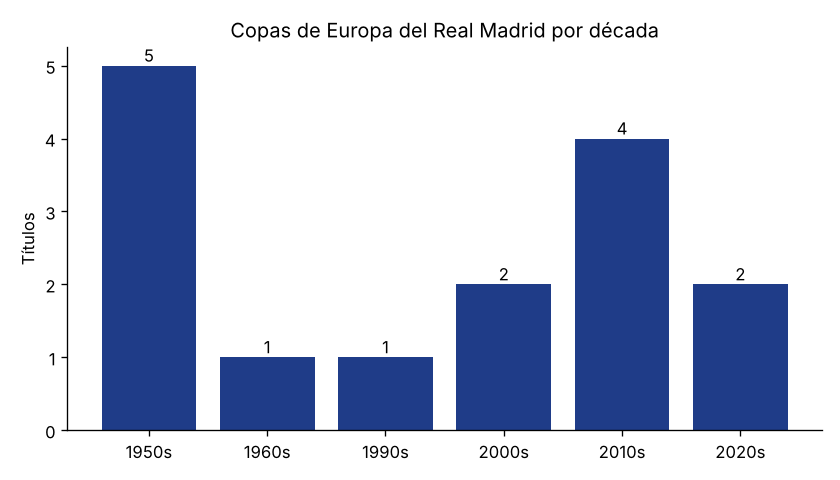
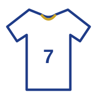
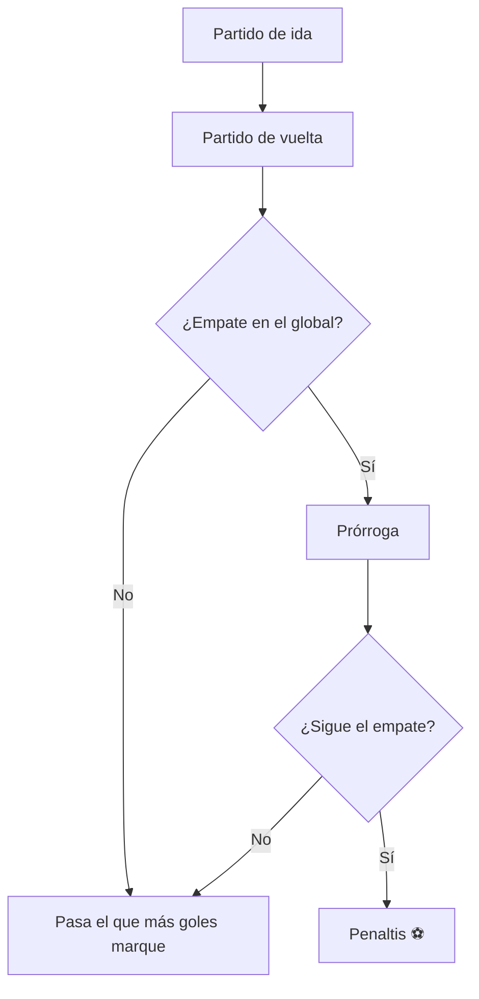
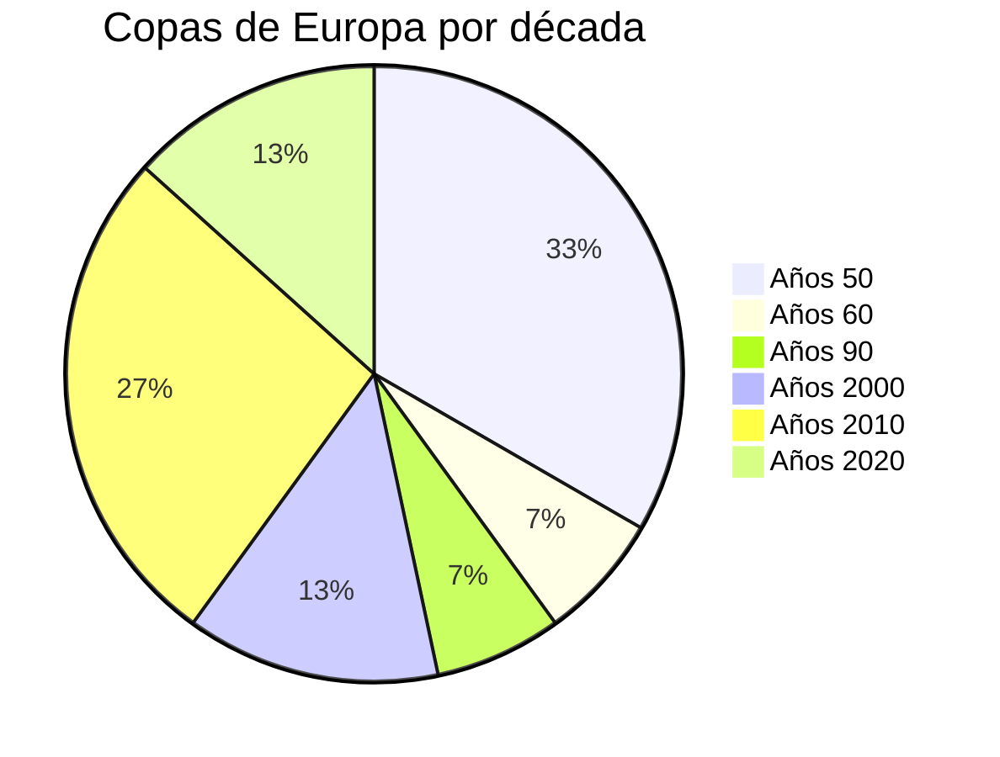
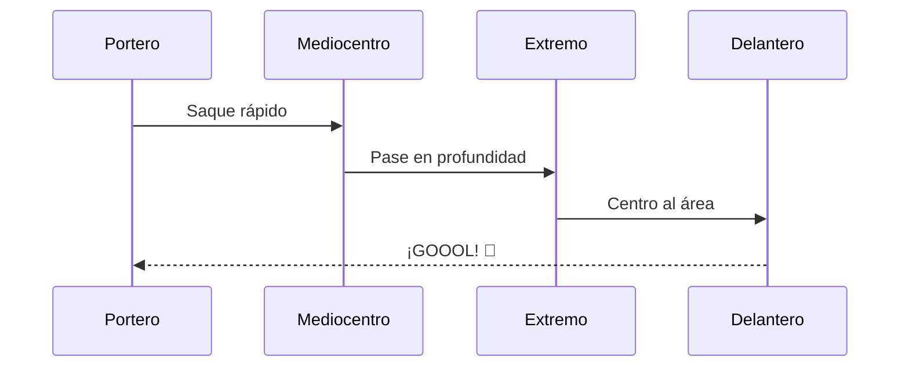
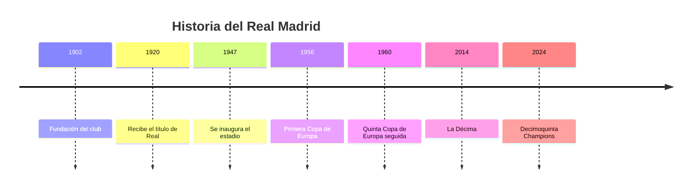

<!-- README del trabajo de Markdown. Tema elegido: el Real Madrid -->
<!-- Autor: Samuel Cruz López -->

<div align="center">
  
  <h1>⚽ Real Madrid Club de Fútbol 🤍</h1>
  <p><i>Trabajo de Markdown sobre mi equipo favorito</i></p>
  <p><b>Autor:</b> Samuel Cruz López</p>
</div>

---

<a id="indice"></a>
## 📑 Índice

1. [👋 Introducción](#introduccion "Ir a la introducción")
2. [📜 Historia del club](#historia "Ir a la historia")
3. [🏆 Palmarés](#palmares "Ir al palmarés")
4. [🏟️ El Santiago Bernabéu](#estadio "Ir al estadio")
5. [⭐ Leyendas del club](#leyendas)
6. [🧮 Estadísticas con fórmulas](#estadisticas)
7. [🔀 Diagramas](#diagramas)
8. [✅ Tareas pendientes](#tareas)
9. [📚 Bibliografía](#bibliografia)

---

<a id="introduccion"></a>
# 👋 Introducción

[⬆️ Volver al índice](#indice)

En este documento voy a hablar del **Real Madrid C.F.**, el club de fútbol con más Copas de Europa de la historia. He elegido este tema porque soy madridista y me parecía más ***entretenido*** que hacer otra cosa más aburrida.

El objetivo de este trabajo es practicar los elementos de *Markdown* que hemos visto en clase.\
Por eso hay tablas, listas, fórmulas, diagramas y alguna que otra cosa más.\
~~Al principio iba a hacerlo sobre el Barça~~ 😅 pero al final no.

> [!NOTE]
> Los datos de este documento están actualizados a **noviembre de 2026** y se han sacado de la web oficial del club y de Wikipedia.

---

<a id="historia"></a>
# 📜 Historia del club

[⬆️ Volver al índice](#indice)

## Los inicios

El club se fundó el **6 de marzo de 1902** con el nombre de *Madrid Foot Ball Club*. En **1920** el rey Alfonso XIII le dio el título de "Real" y desde entonces se llama **Real Madrid**.

## Etapas más importantes

1. **Primeros años (1902 - 1943)**
   - Fundación del club
   - Primeros Campeonatos de España
2. **Era Bernabéu (1943 - 1978)**
   - Construcción del nuevo estadio
   - Las **5 Copas de Europa seguidas** (1956 - 1960)
     1. Fichaje de Di Stéfano
     2. Equipo de Gento y Puskás
3. **La Quinta del Buitre (años 80)**
   - Cinco Ligas seguidas
4. **Los Galácticos (años 2000)**
   - Zidane, Figo, Ronaldo, Beckham...
5. **La época moderna (2014 - 2024)**
   - Seis Champions en diez años 🤯

### Datos rápidos

- 📅 Fundación: 1902
- 🎨 Colores: blanco (por eso les dicen *los blancos* o *los merengues*)
- 📍 Ciudad: Madrid

> *«Ningún jugador es tan bueno como todos juntos.»*
>
> — **Alfredo Di Stéfano**, leyenda del Real Madrid

Si quieres saber más cosas, mira el archivo de [curiosidades](docs/curiosidades.md "Abrir curiosidades del club") que he puesto en la carpeta `docs`.

---

<a id="palmares"></a>
# 🏆 Palmarés

[⬆️ Volver al índice](#indice)

## Títulos principales

En esta tabla están los títulos más importantes (la primera columna alineada a la izquierda, la segunda centrada y la tercera a la derecha):

| Competición           | Ámbito        | Títulos |
|:----------------------|:-------------:|--------:|
| Copa de Europa / Champions League | 🌍 Europa | 15 |
| Liga española         | 🇪🇸 España    | 36 |
| Copa del Rey          | 🇪🇸 España    | 20 |
| Supercopa de Europa   | 🌍 Europa     | 6  |
| Mundial de Clubes / Intercontinental | 🌎 Mundo | 9 |

<!-- OJO: el número de Ligas y Copas está contado hasta 2025, revisar si cambia -->

> [!IMPORTANT]
> El Real Madrid tiene **15 Copas de Europa**, más que ningún otro club. La última fue en **2024** en Wembley contra el Borussia Dortmund (0-2).

## Finales de la Copa de Europa ganadas

<details>
<summary>👉 Pulsa aquí para ver las 15 finales ganadas</summary>
<br>

| Nº | Año  | Rival             |
|:--:|:----:|:------------------|
| 1  | 1956 | Stade de Reims    |
| 2  | 1957 | Fiorentina        |
| 3  | 1958 | AC Milan          |
| 4  | 1959 | Stade de Reims    |
| 5  | 1960 | Eintracht Frankfurt |
| 6  | 1966 | Partizán          |
| 7  | 1998 | Juventus          |
| 8  | 2000 | Valencia          |
| 9  | 2002 | Bayer Leverkusen  |
| 10 | 2014 | Atlético de Madrid |
| 11 | 2016 | Atlético de Madrid |
| 12 | 2017 | Juventus          |
| 13 | 2018 | Liverpool         |
| 14 | 2022 | Liverpool         |
| 15 | 2024 | Borussia Dortmund |

</details>

Aquí hay una gráfica que he hecho con Python de las Champions por década:



---

<a id="estadio"></a>
# 🏟️ El Santiago Bernabéu

[⬆️ Volver al índice](#indice)

El estadio del Real Madrid es el **Santiago Bernabéu**, que se inauguró en **1947** y lleva el nombre del presidente más importante de la historia del club. Hace poco lo reformaron entero y ahora tiene techo retráctil y un césped que se guarda debajo del suelo.


| Dato                | Valor                       |
|--------------------:|:----------------------------|
| Inauguración        | 14 de diciembre de 1947     |
| Capacidad aprox.    | ~78.000 espectadores        |
| Ubicación           | Paseo de la Castellana, Madrid |
| Metro               | Línea 10 (Santiago Bernabéu) |

> [!TIP]
> Si vas a Madrid, merece la pena hacer el **Tour del Bernabéu**. Para llegar en metro solo tienes que bajarte en la parada *Santiago Bernabéu* de la línea 10.

> *«Noventa minuti en el Bernabéu son molto longo.»*
>
> — **Juanito**, exjugador del Real Madrid

---

<a id="leyendas"></a>
# ⭐ Leyendas del club

[⬆️ Volver al índice](#indice)

Estos son algunos de los jugadores más importantes de la historia del club. Los máximos goleadores están ordenados por goles:

| Jugador             | Posición    | Goles | Partidos |
|:--------------------|:-----------:|------:|---------:|
| Cristiano Ronaldo   | Delantero   | 450   | 438      |
| Karim Benzema       | Delantero   | 354   | 648      |
| Raúl González       | Delantero   | 323   | 741      |
| Alfredo Di Stéfano  | Delantero   | 308   | 396      |

<div align="center">
  
  <br>
  <sub>El <b>7</b>, el dorsal más mítico del Madrid (Juanito, Butragueño, Raúl, Cristiano...)</sub>
</div>

### Otros nombres que no pueden faltar

- **Porteros**: Iker Casillas, Thibaut Courtois
- **Defensas**: Sergio Ramos, Roberto Carlos, Marcelo
- **Centrocampistas**:
  - Luka Modrić
  - Toni Kroos
  - Zinedine Zidane

> [!WARNING]
> Los goles de la tabla son de **todas las competiciones oficiales** con el Real Madrid, no solo de Liga.

---

<a id="estadisticas"></a>
# 🧮 Estadísticas con fórmulas

[⬆️ Volver al índice](#indice)

## Puntos en Liga

En la Liga una victoria vale 3 puntos y un empate 1, así que los puntos se calculan con $P = 3V + E$, donde $V$ son las victorias y $E$ los empates.

$$
P = 3 \cdot V + 1 \cdot E + 0 \cdot D
$$

## Media de goles por partido

La media de goles de un jugador se calcula así:

$$
\bar{x} = \frac{\text{goles}}{\text{partidos}} \quad \Rightarrow \quad \bar{x}_{CR7} = \frac{450}{438} \approx 1{,}03
$$

O sea, Cristiano marcó **más de un gol por partido** de media. 🐐

## Porcentaje de finales de Champions ganadas

El Madrid ha jugado 18 finales de la Copa de Europa y ha ganado 15:

$$
\%_{\text{finales}} = \frac{15}{18} \times 100 \approx 83{,}3\,\%
$$

## Goles totales de una temporada

Si $g_i$ son los goles del partido $i$ y una temporada de Liga tiene 38 jornadas:

$$
G_{\text{total}} = \sum_{i=1}^{38} g_i
$$

## Ocupación del estadio

El porcentaje de ocupación es $O = \frac{A}{C} \times 100$, siendo $A$ los asistentes y $C$ la capacidad. Por ejemplo, con $A = 74\,000$ y $C = 78\,000$ sale $O \approx 94{,}9\,\%$.

### Ejemplo en código

He hecho este pequeño script en `Python` para calcular los puntos:

```python
def calcular_puntos(victorias, empates):
    """Devuelve los puntos de un equipo en Liga."""
    return victorias * 3 + empates

print(calcular_puntos(28, 6))  # 90 puntos
```

Y los datos del club guardados en formato `JSON`:

```json
{
  "nombre": "Real Madrid C.F.",
  "fundacion": 1902,
  "estadio": "Santiago Bernabéu",
  "champions": 15
}
```

---

<a id="diagramas"></a>
# 🔀 Diagramas

[⬆️ Volver al índice](#indice)

## 1. Diagrama de flujo: ¿Qué pasa en una eliminatoria de Champions?



## 2. Diagrama de pastel: Champions por década



## 3. Diagrama de secuencia: Un gol a la contra



## 4. Línea de tiempo: Historia del club



---

<a id="tareas"></a>
# ✅ Tareas pendientes

[⬆️ Volver al índice](#indice)

Lista de cosas que tenía que hacer para este trabajo:

- [x] Elegir el tema
- [x] Hacer el índice con enlaces
- [x] Poner tablas, listas y citas
- [x] Añadir fórmulas en LaTeX
- [x] Hacer los diagramas con Mermaid
- [ ] Ir a ver un partido al Bernabéu 🎟️
- [ ] Subirlo a GitHub

Para guardar el archivo en el editor se pulsa <kbd>Ctrl</kbd> + <kbd>S</kbd>.

---

<a id="bibliografia"></a>
# 📚 Bibliografía

[⬆️ Volver al índice](#indice)

- 🌐 [Web oficial del Real Madrid](https://www.realmadrid.com "Página oficial del club")
- 📖 [Real Madrid en Wikipedia](https://es.wikipedia.org/wiki/Real_Madrid_Club_de_F%C3%BAtbol "Artículo de Wikipedia")
- 🏟️ [Estadio Santiago Bernabéu en Wikipedia](https://es.wikipedia.org/wiki/Estadio_Santiago_Bernab%C3%A9u)
- 🏆 [UEFA Champions League](https://www.uefa.com/uefachampionsleague/ "Web oficial de la UEFA")
- 📝 [Guía de Markdown de GitHub](https://docs.github.com/es/get-started/writing-on-github)

---

<div align="center">
  <p>Hecho con 🤍 por <b>Samuel Cruz López</b></p>
  <p><b>¡Hala Madrid!</b> ⚽</p>
</div>
